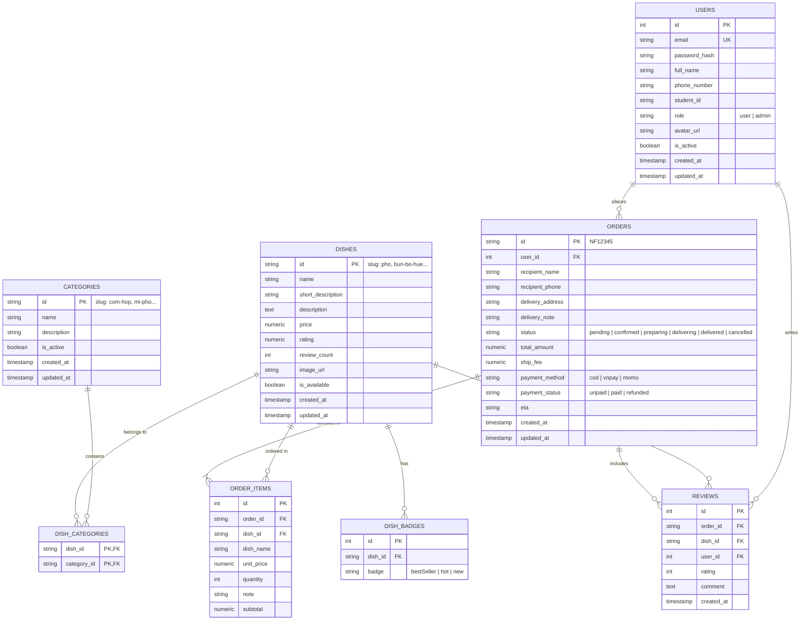

# Tài Liệu Thiết Kế Cơ Sở Dữ Liệu NEUFood 🗄️

Hệ thống cơ sở dữ liệu quan hệ cho NEUFood sử dụng **PostgreSQL 16+**, hỗ trợ mở rộng, ràng buộc toàn vẹn dữ liệu, trigger cập nhật thời gian và chỉ mục tối ưu truy vấn.

---

## 1. Sơ Đồ Thực Thể Quan Hệ (Entity-Relationship Diagram - ERD)



---

## 2. Chi Tiết Các Tệp SQL

- `init_db.sql`: Định nghĩa cấu trúc DDL hoàn chỉnh (Bảng, Khóa chính, Khóa ngoại, Ràng buộc kiểm tra, Extension, Trigger tự động cập nhật `updated_at`, Chỉ mục Index).
- `sample_data.sql`: Dữ liệu mẫu ban đầu (Danh mục món, Danh sách món ăn khớp với frontend, Tài khoản Admin mặc định, Đơn hàng mẫu và đánh giá).

---

## 3. Hướng Dẫn Cài Đặt Cục Bộ

### Sử dụng Docker (Khuyến nghị)
Khi khởi chạy bằng Docker Compose, hai tệp `init_db.sql` và `sample_data.sql` sẽ tự động được chạy trong thư mục `/docker-entrypoint-initdb.d/`:
```bash
docker compose up database -d
```

### Sử dụng psql thủ công
```bash
# Tạo cơ sở dữ liệu
createdb -U postgres neufood_db

# Chạy DDL schema
psql -U postgres -d neufood_db -f database/init_db.sql

# Nạp dữ liệu mẫu
psql -U postgres -d neufood_db -f database/sample_data.sql
```
