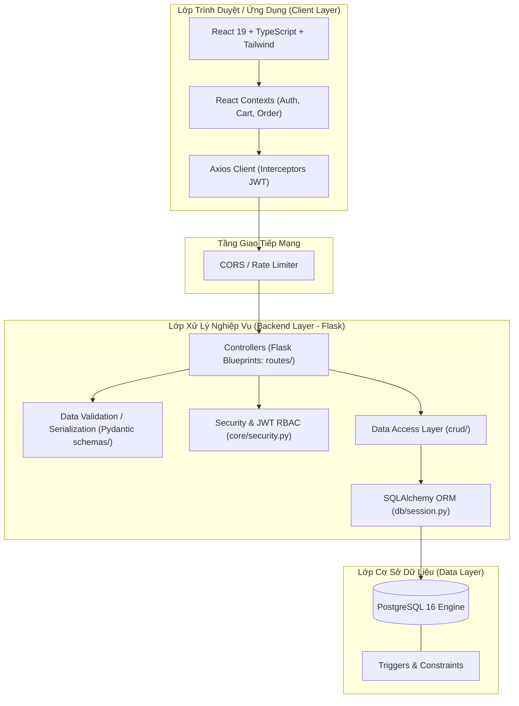

# Kiến Trúc Tổng Thể Hệ Thống NEUFood 🏛️

Tài liệu mô tả thiết kế kiến trúc kỹ thuật, mô hình phân lớp và luồng dữ liệu của nền tảng **NEUFood**.

---

## 1. Mô Hình Kiến Trúc Tổng Thể (System Architecture)

Hệ thống được xây dựng theo mô hình 3 lớp (3-Tier Architecture) hiện đại, phân tách hoàn toàn giữa Giao diện người dùng (Frontend SPA), Dịch vụ xử lý nghiệp vụ (Backend API), và Tầng lưu trữ bền vững (Database):

---

## 2. Luồng Xử Lý Một Request (Request Lifecycle)

1. **HTTP Request**: Người dùng tương tác trên Frontend, Axios gửi request kèm `Authorization: Bearer <token>` nếu cần.
2. **CORS & Limiter Middleware**: Kiểm tra nguồn gốc request và giới hạn tần suất gửi yêu cầu để chống DDOS / Brute-force.
3. **Route Dispatcher**: Điều hướng tới hàm Controller tương ứng trong thư mục `backend/app/routes/`.
4. **Authentication / Authorization Check**: Decorator `@jwt_required` hoặc `@role_required('admin')` trích xuất token, xác thực chữ ký và kiểm tra phân quyền.
5. **Request Validation**: Pydantic schema kiểm tra kiểu dữ liệu, các ràng buộc bắt buộc (email hợp lệ, số điện thoại, mật khẩu).
6. **Data Access (CRUD)**: Tầng `crud/` thực hiện câu truy vấn thông qua SQLAlchemy scoped session.
7. **Database Execution**: PostgreSQL thực thi query, kích hoạt các trigger và index tương ứng.
8. **Response Formatting**: Kết quả được định dạng thành JSON chuẩn và phản hồi về cho Frontend.

---

## 3. Kiến Trúc Phân Lớp Backend (Backend Layering)

- **`app/core/`**: Chứa các thành phần hạt nhân không đổi: Cấu hình hệ thống nạp từ biến môi trường (`config.py`), thuật toán mã hóa mật khẩu và sinh mã JWT (`security.py`), khởi tạo giới hạn tần suất gọi API (`limiter.py`).
- **`app/db/`**: Quản lý vòng đời kết nối cơ sở dữ liệu (`session.py`), cung cấp `get_db()` context manager đảm bảo tự động commit/rollback và đóng session sau mỗi request.
- **`app/schemas/`**: Khai báo các Pydantic Models định nghĩa kiểu dữ liệu cho đầu vào (Input DTO) và đầu ra (Output DTO).
- **`app/crud/`**: Data Access Object (DAO) thuần túy thực hiện các phép toán Create, Read, Update, Delete với database, giúp code ở controller cực kỳ gọn gàng và dễ viết Unit Test.
- **`app/routes/`**: Các Flask Blueprints đóng vai trò là API Controllers điều phối và trả dữ liệu.
- **`app/utils/`**: Các hàm phụ trợ chung như chuẩn hóa response JSON, xử lý upload file ảnh, format ngày tháng.

---

## 4. Kiến Trúc Frontend (Frontend Architecture)

- **`src/routes/`**: Tập trung định tuyến bằng React Router DOM v7, kèm `ProtectedRoute.tsx` để bảo vệ các tuyến đường yêu cầu đăng nhập hoặc quyền Admin.
- **`src/pages/`**: Phân tách rõ ràng giữa `auth/`, `admin/`, `user/` và `not-found/`.
- **`src/components/`**: Chia thành `common/` (các UI atoms có thể tái sử dụng cao như Button, Input, Modal, Table), `layout/` (Navbar, Sidebar, Footer, MainLayout) và các module nghiệp vụ (`dishes/`, `orders/`, `chatbot/`).
- **`src/services/`**: Tập hợp các hàm gọi API thông qua Axios instance duy nhất đã cài đặt interceptor tự động chèn JWT token và xử lý lỗi 401.
- **`src/contexts/`**: Quản lý State toàn cục bằng React Context API (CartContext lưu giỏ hàng, AuthContext lưu phiên đăng nhập người dùng, MenuSearchContext phục vụ tìm kiếm).
